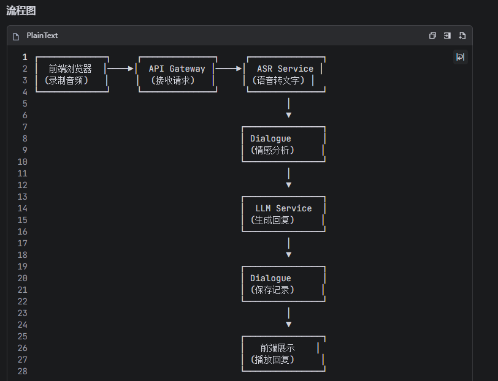

# AI Person — 实时语音对话系统

基于微服务架构的语音对话系统，覆盖「语音识别 → 情绪感知 → 大模型对话 → 记忆管理 → 语音合成」完整链路。各能力以独立服务提供，通过 API Gateway 统一编排，支持 Docker Compose 一键部署，也支持无 GPU 的 Mock 模式本地调试。



## 核心能力

- **语音识别（ASR）**：FunASR Paraformer，支持 ONNX 推理
- **大模型对话（LLM）**：vLLM / Ollama / Mock 三种后端可切换
- **语音合成（TTS）**：GPT-SoVITS，支持音色克隆
- **情绪识别**：对话文本实时情绪分析，并注入对话上下文
- **对话记忆**：短期会话记忆 + 长期记忆持久化，支持 Redis
- **性能优化**：多级缓存、连接池、分布式部署
- **可观测性**：Prometheus + Grafana 监控，各服务统一 `/health` 与 `/stats`

## 服务一览

| 服务 | 端口 | 技术栈 | 职责 |
| --- | --- | --- | --- |
| api-gateway | 8000 | FastAPI + httpx | 统一入口、请求编排、静态 Web 页面 |
| llm-service | 8001 | vLLM / Ollama | 文本生成、多轮对话 |
| asr-service | 8002 | FunASR | 语音转文字 |
| tts-service | 8003 | GPT-SoVITS | 文字转语音 |
| dialogue-service | 8004 | Python + Redis | 会话记忆、情绪识别、历史检索 |
| ollama | 11434 | Ollama | 本地模型推理后端 |
| redis-cache | 6380 → 6379 | Redis 7 | 缓存与会话状态 |
| prometheus | 9090 | Prometheus | 指标采集 |
| grafana | 3000 | Grafana | 监控面板 |

## 目录结构

```
AI_person/
├── api-gateway/           # 统一 API 网关（FastAPI）与 Web 前端
│   ├── api/               # 路由与请求模型
│   ├── core/              # 缓存、对话、情感、语音流水线、LLM 连接器
│   ├── config/            # 模型与应用配置（model_config.yaml）
│   ├── static/            # 前端页面
│   ├── utils/             # 音频与日志工具
│   └── main.py
├── asr-service/           # 语音识别服务（FunASR）
├── llm-service/           # 大模型服务（vLLM / Ollama / Mock）
├── tts-service/           # 语音合成服务（GPT-SoVITS）
├── dialogue-service/      # 对话记忆与情绪识别服务
├── ollama-service/        # Ollama 镜像构建（需自备安装包）
├── models/                # 模型目录（权重不入库）+ 模型注册表 registry.py
├── data/                  # 运行时数据：缓存 / 记忆 / 音色 / 训练数据（不入库）
├── config/                # Redis 配置
├── monitoring/            # Prometheus / Grafana 配置
├── scripts/               # 模型下载、音色训练脚本
├── tests/                 # 测试
├── docker-compose.yml     # 全栈编排
├── start_services.py      # 单进程 Mock 模式启动器
├── run.sh / run.bat       # Docker 管理脚本
└── requirements.txt       # 根依赖清单
```

## 快速开始

### 方式一：Docker Compose（完整能力，需要 NVIDIA GPU）

**1. 准备模型文件**

模型权重体积较大，不纳入版本库，需按以下路径自行下载：

```
models/
├── asr/speech_paraformer-large/   # FunASR Paraformer
├── llm/qwen2-7b/                  # LLM（vLLM 后端使用）
├── tts/gpt_sovits_v2/             # GPT-SoVITS
└── ollama/                        # Ollama 模型仓库挂载点
```

可用脚本下载部分模型：

```bash
python scripts/download_models.py --type asr --name paraformer-large
python scripts/download_models.py --type llm --name Qwen/Qwen2-7B-Instruct
```

**2. 准备 Ollama 安装包**

Ollama 镜像构建依赖本地安装包（约 1.6GB，不入库）：

```
ollama-service/ollama-linux-amd64.tgz
```

从 <https://ollama.com/download> 下载 Linux AMD64 版本后放入上述路径。

**3. 配置环境变量**

```bash
cp .env.example .env
# 按需修改 LLM_BACKEND、OLLAMA_MODEL、GRAFANA_PASSWORD 等
```

**4. 启动**

```bash
# Linux / macOS
./run.sh start

# Windows
run.bat start
```

启动后访问：

- Web 对话界面：<http://localhost:8000>
- API 文档：<http://localhost:8000/docs>
- Grafana：<http://localhost:3000>（默认 admin / admin）
- Prometheus：<http://localhost:9090>

### 方式二：本地 Mock 模式（无需 GPU / 无需模型）

`start_services.py` 仅依赖 Python 标准库，可在同一进程内拉起 8000~8004 五个 HTTP 服务，ASR / LLM / TTS 返回模拟结果，用于联调前后端与接口协议：

```bash
python start_services.py
```

启动后打开 <http://localhost:8000> 即可体验对话页面。

## 配置项

| 环境变量 | 默认值 | 说明 |
| --- | --- | --- |
| `LLM_BACKEND` | `mock` | LLM 后端：`mock` / `vllm` / `ollama` |
| `OLLAMA_BASE_URL` | `http://localhost:11434` | Ollama 地址 |
| `OLLAMA_MODEL` | `qwen2:7b` | Ollama 模型名 |
| `VLLM_BASE_URL` | `http://localhost:8000/v1` | vLLM 服务地址 |
| `VLLM_MODEL` | `qwen2-7b` | vLLM 模型名 |
| `OPENAI_API_KEY` | 空 | 外部 OpenAI 兼容接口密钥 |
| `GRAFANA_PASSWORD` | `admin` | Grafana 管理员密码 |
| `LOG_LEVEL` | `INFO` | 日志级别 |

各服务的模型路径、量化方式、显存限制等配置见 [docker-compose.yml](docker-compose.yml) 与 [model_config.yaml](api-gateway/config/model_config.yaml)。

## API 说明

### API Gateway

| 方法 | 路径 | 说明 |
| --- | --- | --- |
| GET | `/` | 重定向到 Web 对话页面 |
| GET | `/api/health` | 网关健康检查 |
| GET | `/api/services` | 各下游服务健康状态 |
| POST | `/api/dialogue` | 文本对话：情绪识别 → 载入历史 → LLM 生成 → 写入记忆 |
| POST | `/api/dialogue/audio` | 语音对话：ASR → 情绪识别 → LLM 生成 → 写入记忆 |

文本对话请求示例：

```bash
curl -X POST http://localhost:8000/api/dialogue \
  -H "Content-Type: application/json" \
  -d '{"session_id": "demo", "text": "今天有点累"}'
```

### 各微服务

| 服务 | 主要端点 |
| --- | --- |
| llm-service | `POST /chat`、`POST /generate`、`GET /health`、`GET /stats` |
| asr-service | `POST /recognize`、`GET /health`、`GET /stats`、`GET /stats/recent` |
| tts-service | `POST /synthesize`、`POST /synthesize/audio`、`GET /voices`、`GET /health` |
| dialogue-service | `POST /turn`、`GET/DELETE /history/{session_id}`、`POST /emotion`、`POST /search`、`GET /stats/memory` |

## 开发与测试

```bash
pip install -r requirements.txt
pytest
```

单服务本地调试（以网关为例）：

```bash
cd api-gateway
pip install -r requirements.txt
uvicorn main:app --host 0.0.0.0 --port 8000 --reload
```

## 版本库说明

本仓库**不包含**以下内容，克隆后需按上文自行准备：

- `models/` 下的模型权重（仅保留 `registry.py`、`__init__.py` 源码）
- `data/` 运行时数据（缓存、记忆、音色、训练数据）
- `logs/` 日志
- `download/` 与 `ollama-service/*.tgz` 第三方安装包
- `.env` 等本地环境配置

## 已知问题

- api-gateway 镜像的 `HEALTHCHECK` 探测 `/health`，而应用实际暴露的是 `/api/health`，可能导致容器被标记为 unhealthy；本地调试不影响功能。
